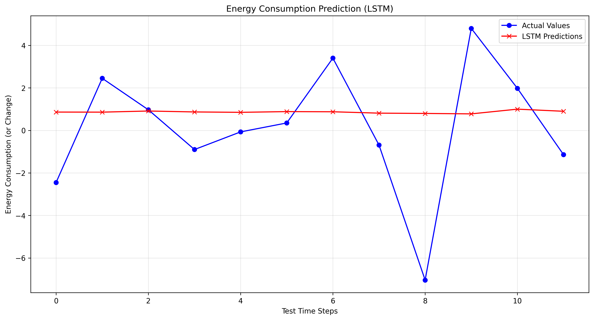

# World Energy Consumption Forecasting (LSTM)

An end-to-end deep learning pipeline built with TensorFlow/Keras to forecast US primary energy consumption (1965–2023) using chronologically-split time-series sequences, robust scaling, and an optimized LSTM architecture.

## Pipeline Architecture
- **Data Processing:** Chronological train-test split (80/20) avoiding data leakage.
- **Normalization:** `StandardScaler` applied strictly to training statistics.
- **Model:** LSTM neural network with explicit Input layer, Dropout regularization, and Early Stopping.

## Evaluation Results
- **MAE:** 2.26
- **RMSE:** 2.99
- **R-Square:** -0.0394

## Prediction Visualization

